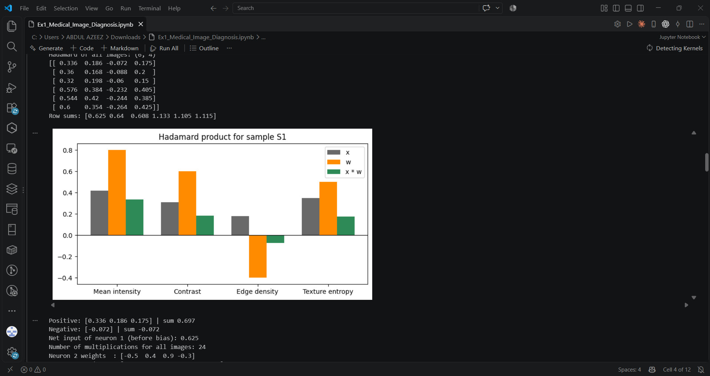
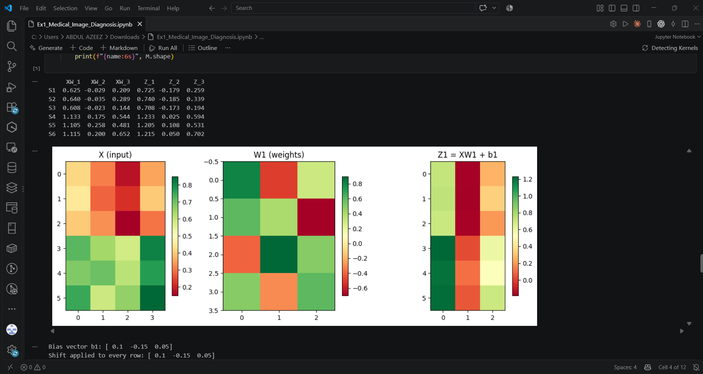
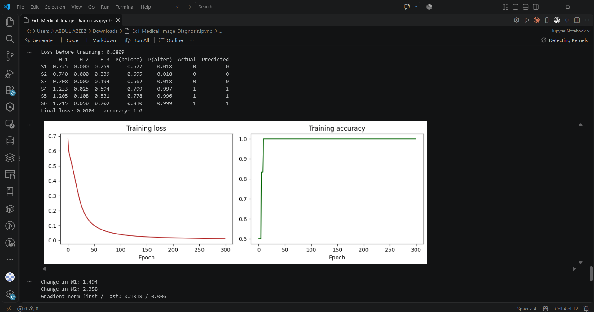

# Medical Image Diagnosis using Vectors and Matrices

Forward propagation on medical image features using the Hadamard product, matrix multiplication and bias addition.

## Plot 1: Hadamard product of sample S1

## Plot 2: Heatmaps of the input X, weights W1 and pre-activation Z1

## Plot 3: Training loss and accuracy over 300 epochs

